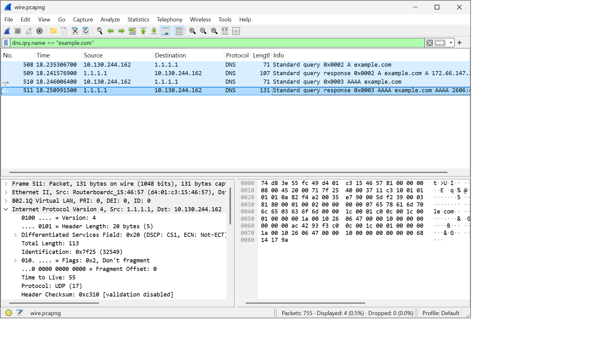
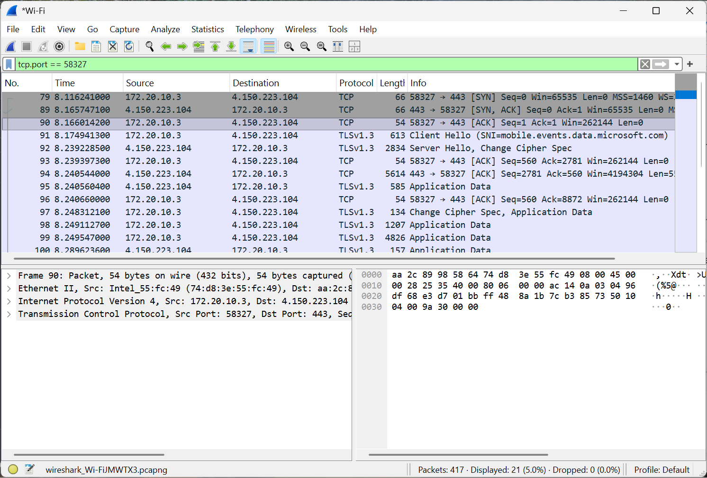

# DNS Traffic Investigation

## Project Objective

Capture and analyze DNS traffic using Wireshark to understand how domain names are resolved into IP addresses and how security analysts investigate DNS communication.

## Tools and Technologies

- Wireshark
- Windows PowerShell
- DNS (Domain Name System)
- TCP/IP networking

## Methodology

1. Started a live packet capture using Wireshark.
2. Generated DNS traffic using the command `nslookup example.com 1.1.1.1`.
3. Applied the Wireshark display filter:

   `dns.qry.name == "example.com"`

4. Identified DNS queries and corresponding responses.
5. Examined the source and destination IP addresses, query types, and DNS transaction IDs.

## Packet Analysis

| Packet Number | Source IP | Destination IP | Description |
|---|---|---|---|
| 508 | 10.130.244.162 | 1.1.1.1 | DNS A query |
| 509 | 1.1.1.1 | 10.130.244.162 | DNS A response |
| 510 | 10.130.244.162 | 1.1.1.1 | DNS AAAA query |
| 511 | 1.1.1.1 | 10.130.244.162 | DNS AAAA response |

## Findings

- The client IP address was `10.130.244.162`.
- DNS queries were sent to the resolver `1.1.1.1`.
- The requested domain was `example.com`.
- The client requested both IPv4 (A record) and IPv6 (AAAA record) addresses.
- Both DNS queries received responses.
- DNS transaction IDs helped associate the requests with their corresponding responses.

## Security Significance

DNS analysis is important in cybersecurity because attackers may use DNS to communicate with malicious infrastructure, discover network resources, or establish command-and-control communications.

Security Operations Center (SOC) analysts can investigate unusual DNS queries, suspicious domains, and patterns of repeated requests to identify potential threats.

The packets examined during this investigation were consistent with normal DNS resolution. No malicious activity was identified in the analyzed packets.

## Conclusion

Successfully captured and analyzed DNS requests and responses using Wireshark. This investigation demonstrated how DNS resolution works and how packet analysis can support cybersecurity monitoring and incident investigations.

## Evidence

# TCP Three-Way Handshake Investigation

## Project Objective

Capture and analyze a TCP three-way handshake using Wireshark to understand how devices establish reliable network connections and how security analysts investigate TCP communication.

## Tools and Technologies

- Wireshark
- Windows
- TCP/IP
- TLS 1.3
- HTTPS (Port 443)

## Methodology

1. Started a live packet capture on the active Wi-Fi interface.
2. Generated network traffic while recording packets.
3. Applied the Wireshark display filter:

   `tcp.flags.syn == 1`

4. Identified SYN and SYN-ACK packets.
5. Applied a second filter to isolate the TCP connection:

   `tcp.port == 58327`

6. Located and examined the SYN, SYN-ACK, and ACK packets.
7. Inspected packet headers, source and destination addresses, port numbers, and TCP flags.

## Packet Analysis

| Packet | Source IP | Destination IP | TCP Flags |
|---|---|---|---|
| 79 | 172.20.10.3 | 4.150.223.104 | SYN |
| 89 | 4.150.223.104 | 172.20.10.3 | SYN-ACK |
| 90 | 172.20.10.3 | 4.150.223.104 | ACK |

### Connection Details

- Client IP: `172.20.10.3`
- Server IP: `4.150.223.104`
- Client port: `58327`
- Server port: `443`
- Protocol: TCP
- TCP stream index: `6`

## TCP Three-Way Handshake Breakdown

### Step 1 — SYN (Packet 79)

The client initiated a TCP connection by sending a SYN packet to the remote server on port 443.

This packet indicated that the client wanted to establish a TCP session.

### Step 2 — SYN-ACK (Packet 89)

The server responded with a SYN-ACK packet, acknowledging the client's request and initiating its side of the connection.

This confirmed that the server was responding to the connection attempt.

### Step 3 — ACK (Packet 90)

The client sent the final ACK packet to complete the three-way handshake.

Packet 90 contained the following information:

- Source port: `58327`
- Destination port: `443`
- Sequence number: `1`
- Acknowledgment number: `1`
- TCP payload length: `0 bytes`

This completed the TCP connection establishment process.

## Additional Observations — TLS 1.3

After the three-way handshake, I observed TLS 1.3 communication, including:

- Client Hello
- Server Hello
- Encrypted application data

The Client Hello referenced the hostname `SNT-mobile.events.data.microsoft.com`.

These observations demonstrate that the established TCP connection was subsequently used for encrypted communication.

## Security Significance

TCP handshake analysis helps SOC analysts investigate:

- Failed TCP connection attempts
- Suspicious port scanning
- Potential SYN flood attacks
- Unusual connection behavior
- Network connectivity problems

Repeated SYN packets without corresponding completed handshakes can be an indicator worth investigating, although additional context is needed to determine whether activity is malicious.

The packets examined during this investigation demonstrated a successfully established TCP connection. No malicious activity was confirmed.

## Conclusion

Successfully captured and analyzed a complete TCP three-way handshake using Wireshark.

Identified the SYN, SYN-ACK, and ACK packets, inspected TCP header information, and observed TLS 1.3 communication following connection establishment.

This investigation strengthened my understanding of TCP/IP networking, packet inspection, and network security monitoring.

## Evidence

### Complete TCP Handshake

### Final TCP ACK Packet

